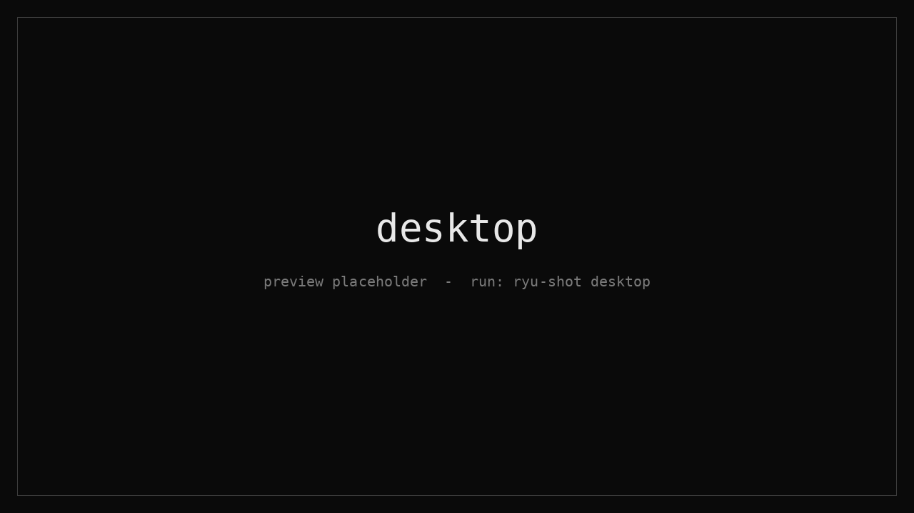
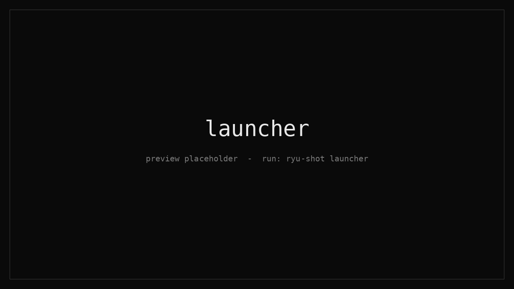
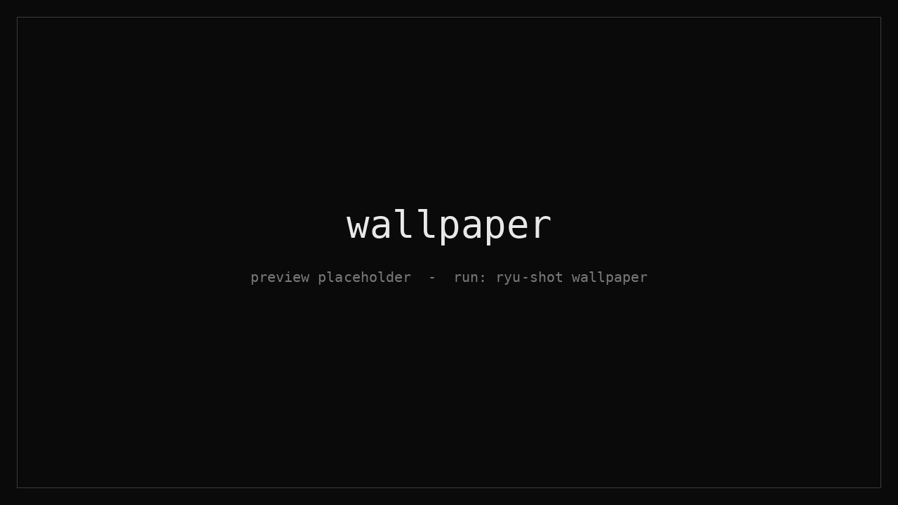

<div align="center">

```
   ┌─┐┬ ┬┬ ┬   ┌┬┐┌─┐┌┬┐┌─┐
   ├┬┘└┬┘│ │─── │││ │ │ └─┐
   ┴└─ ┴ └─┘  ─┴┘└─┘ ┴ └─┘
```

**minimal · monochrome · glass**

A Hyprland rice written in Lua, themed from one palette file, restorable on any distro with one command.


</div>

---

## Preview

<table>
  <tr>
    <td></td>
    <td></td>
  </tr>
  <tr>
    <td align="center"><sub>desktop</sub></td>
    <td align="center"><sub>launcher</sub></td>
  </tr>
  <tr>
    <td></td>
    <td></td>
  </tr>
  <tr>
    <td align="center"><sub>wallpaper picker</sub></td>
    <td align="center"><sub>lockscreen</sub></td>
  </tr>
</table>

## What's inside

| | |
|---|---|
| **Compositor** | Hyprland (Lua config, split into small modules) |
| **Bar** | Waybar, flat and full width |
| **Launcher** | Rofi, square and blurred |
| **Terminal** | Kitty with Iosevka Nerd Font, glass opacity |
| **Lock / idle** | Hyprlock (clock and a line) + Hypridle |
| **Notifications** | Dunst |
| **Prompt** | Starship |
| **Night light** | hyprsunset, warm from 19:00 to 06:30 |
| **Wallpapers** | `ryu-wall`: Rofi thumbnail grid, fade transitions, restores on login |
| **Power menu** | `ryu-power`: lock, logout, suspend, reboot, shutdown |
| **Wi-Fi** | `wifi-menu`: Rofi picker on top of NetworkManager |

One palette drives everything. Change a color in `theme/palette.env`, run `./theme/apply.sh`, and Hyprland, Waybar, Kitty, Rofi, Dunst, Hyprlock and Starship all follow.

## Install

```sh
git clone https://github.com/u4knoin-exe/Ryu-dots ~/Ryu-dots
cd ~/Ryu-dots
./install.sh --dry-run          # preview, changes nothing
./install.sh                    # interactive
./install.sh --yes --all        # distro-hop mode: everything, no questions
```

The installer backs up your old configs (`~/ryu-backup-*.tar.gz`), moves old folders aside, installs only what is missing, and deploys. Re-running is safe.

| Distro | Packages | Notes |
|---|---|---|
| Arch / CachyOS / EndeavourOS | pacman + AUR (paru built if missing) | fully supported |
| Fedora | dnf + COPR `solopasha/hyprland` | best effort, failures are listed |
| Debian / Ubuntu | apt | Hyprland 0.55+ usually needs a separate install |
| NixOS / other | skipped | configs still deploy |

<details>
<summary><b>Extras and flags</b></summary>

| Flag | Does |
|---|---|
| `--brave` | Brave Origin (AUR `brave-origin-bin`, or Brave's apt/dnf repos, or its install script) |
| `--spotify` | Spotify, then Spicetify + Marketplace (log into Spotify once, then `ryu-spicetify`) |
| `--flatpak` | Flatpak + Flathub |
| `--all` / `--no-extras` | all extras / none |
| `--yes` | no questions |
| `--dry-run` | print what would happen |
| `--no-pkgs` / `--no-backup` | skip packages / backup |
| `--uninstall` | remove everything it linked and offer to restore your backup |

</details>

## Keybinds

<details open>
<summary><b>Everyday</b></summary>

| Key | Action |
|---|---|
| `Super + Return` | Terminal |
| `Super + Space` | Launcher |
| `Super + W` | Wallpaper picker (`+ Ctrl` for random) |
| `Super + Shift + W` | Wi-Fi menu |
| `Super + N` | Night light toggle |
| `Super + V` | Clipboard history |
| `Super + E` | File manager |
| `Super + L` | Lock |
| `Super + Shift + Q` | Power menu |
| `Print` / `Shift + Print` | Screenshot to clipboard / file |

</details>

<details>
<summary><b>Windows and workspaces</b></summary>

| Key | Action |
|---|---|
| `Super + Q` | Close window |
| `Super + Shift + F` | Toggle float |
| `Super + J` | Toggle split |
| `Super + Arrows` | Move focus |
| `Super + 1..9` | Go to workspace (`+ Shift` moves the window) |
| `Super + S` | Scratchpad (`+ Shift` sends the window) |
| `Super + Mouse L/R` | Drag / resize |
| `Super + Shift + M` | Exit Hyprland |

</details>

## Make it yours

```sh
$EDITOR theme/palette.env       # colors and fonts, one place
./theme/apply.sh                # re-render everything
```

Drop wallpapers in `wallpapers/` and a square `assets/face.png` for the lockscreen avatar. Both travel with the repo to your next machine.

## Layout

```
Ryu-dots
├── install.sh          installer (multi-distro)
├── theme/
│   ├── palette.env     colors + fonts
│   └── apply.sh        link static files, render *.tpl
├── config/             -> ~/.config   (hypr, waybar, kitty, rofi, dunst, starship)
├── home/               -> ~
├── bin/                -> ~/.local/bin (ryu-wall, ryu-power, wifi-menu, nightlight, ryu-spicetify, ryu-shot)
├── wallpapers/         your wallpapers
└── assets/             avatar + README previews
```

Files ending in `.tpl` are rendered from the palette; everything else is symlinked, so editing the repo changes your live config.

## Updating the previews

```sh
ryu-shot desktop          # arrange your windows first (3s delay)
ryu-shot launcher 5       # open the launcher during the 5s
ryu-shot wallpaper 5      # open the picker during the 5s
ryu-shot lock             # locks, captures, then unlock as normal
```

## Troubleshooting

- **Lua API names:** `/usr/share/hypr/stubs/hl.meta.lua` is the source of truth for your Hyprland version.
- **Config errors:** `hyprctl configerrors`
- **Blur missing on bar or launcher:** check layer names with `hyprctl layers`.
- **Two bars or old styling:** the installer moves old folders to `~/.config/<name>.old-*`; check that nothing else autostarts a bar.
- **Lockscreen preview:** run `hyprlock` inside the session.

---

<div align="center"><sub>made by <a href="https://github.com/u4knoin-exe">u4knoin</a></sub></div>
